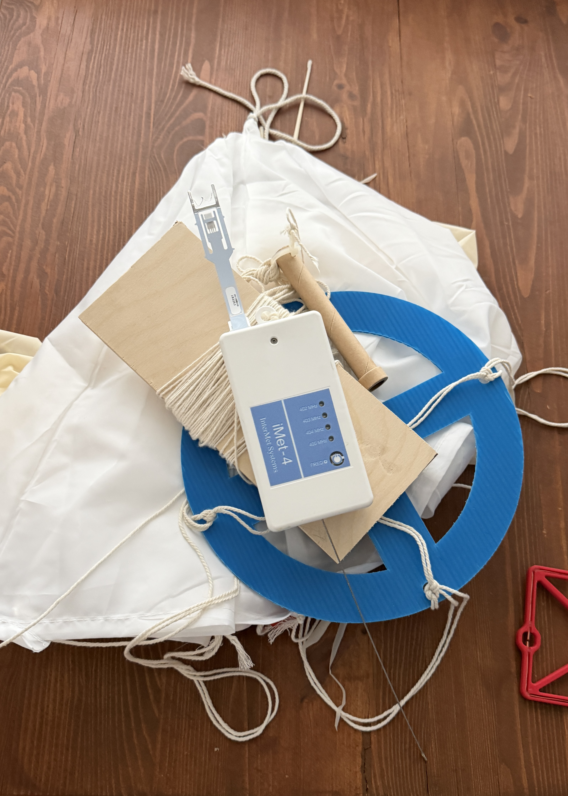

# Recovering an iMet-4 Radiosonde

On September 17th, 2026 I tracked a weather balloon from launch to landing and then went out and recovered the radiosonde it was carrying. The sonde was an Intermet Systems iMet-4, serial number CA0DEDED, transmitting on 404 MHz. It climbed to more than 87,000 feet before the balloon burst, then came down under its parachute in a field northeast of Keenesburg.

<!-- more -->

## What is a radiosonde?

A radiosonde is a small, battery-powered instrument package carried aloft by a weather balloon. On the way up it measures temperature, humidity and pressure, gets its position from GPS, and transmits all of it back to the ground in the 400–406 MHz band. When the balloon bursts, the sonde falls back to earth under a small parachute. Most are never collected, which is where sonde hunters come in.

[SondeHub](https://sondehub.org) is a worldwide network of volunteer receiving stations. Each one runs software such as [radiosonde_auto_rx](https://github.com/projecthorus/radiosonde_auto_rx) to decode the telemetry and upload it, so anyone can follow a flight on a live map and see a predicted landing spot.

## My receiving station

My station is a Raspbery Pi 4 and a RTL-SDRv4 that runs radiosonde_auto_rx 1.8.2 with a Diamond D220S antenna.

<!-- TODO: describe the receiver (SDR model, computer, filter/preamp) and add a photo -->

## The flight

My station picked up CA0DEDED at 5:31 PM MDT, when the sonde was about 1,910 m (6,270 ft) up over north Denver. Eight stations uploaded telemetry during the flight, mine included.

| | |
|---|---|
| Sonde | Intermet iMet-4, serial CA0DEDED |
| Frequency | 404.0 MHz |
| First heard | 5:31 PM MDT, 1,910 m (6,270 ft) |
| Burst | 6:49 PM MDT at 26,645 m (87,418 ft) |
| Coldest reading | −71.2 °C at about 15,960 m (52,360 ft) |
| Ascent | 77 minutes, about 5.3 m/s |
| Descent | 33 minutes, averaging about 13 m/s |
| Landed | about 7:22 PM MDT, northeast of Keenesburg |
| Distance traveled | about 56 km (35 miles) from where I first heard it |

The coldest reading came at the tropopause, around 16 km. Above that the air in the stratosphere gets warmer again, and at burst the sonde read −50.5 °C.

You can replay the whole flight on the [SondeHub map](https://sondehub.org/?sondehub=1#!mt=Mapnik&mz=10&qm=3h&mc=40.12534,-104.47723&f=CA0DEDED&q=CA0DEDED).

<!-- TODO: screenshot of the flight path from SondeHub, e.g.  -->

## The chase

By the time the sonde dropped below about 1,700 m, mine was the only station still hearing it, and I kept receiving it after it landed. That gave me a solid landing position to drive to. I was lucky as the sonde landed right by the road so I was able to park and walk directly to it, no foxchasing required. Since then I have discovered this is extremely lucky and does not always happen when chasing balloons.

<!-- TODO: how you chased it — when you left, how you navigated (phone app, chase car tracker), how long it took -->

## The recovery

It was located in tall grass and laid out in a straight line as there was little wind that evening. Condition was perfect as there were no obstructions, just a clean landing.

<!-- TODO: where it landed (field, fence line, tree?), whether you needed landowner permission, condition of the sonde, parachute and balloon remnants -->

<!-- TODO: recovery photos, e.g.  -->

## What's inside an iMet-4

<!-- TODO: teardown notes and photos — battery, GPS antenna, sensor boom, whether you plan to reprogram or reuse it -->

## Lessons learned

I live to the west of where the sondes are typically launched and the prevailing winds blow to the east in Denver so the quicker I can get in the car to chase the easier it is for me to locate the sonde as or right as it is landing. Also having an exterior antenna helps a lot instead of leaving an antenna draped across your dashboard.

73, Casey NV9P
